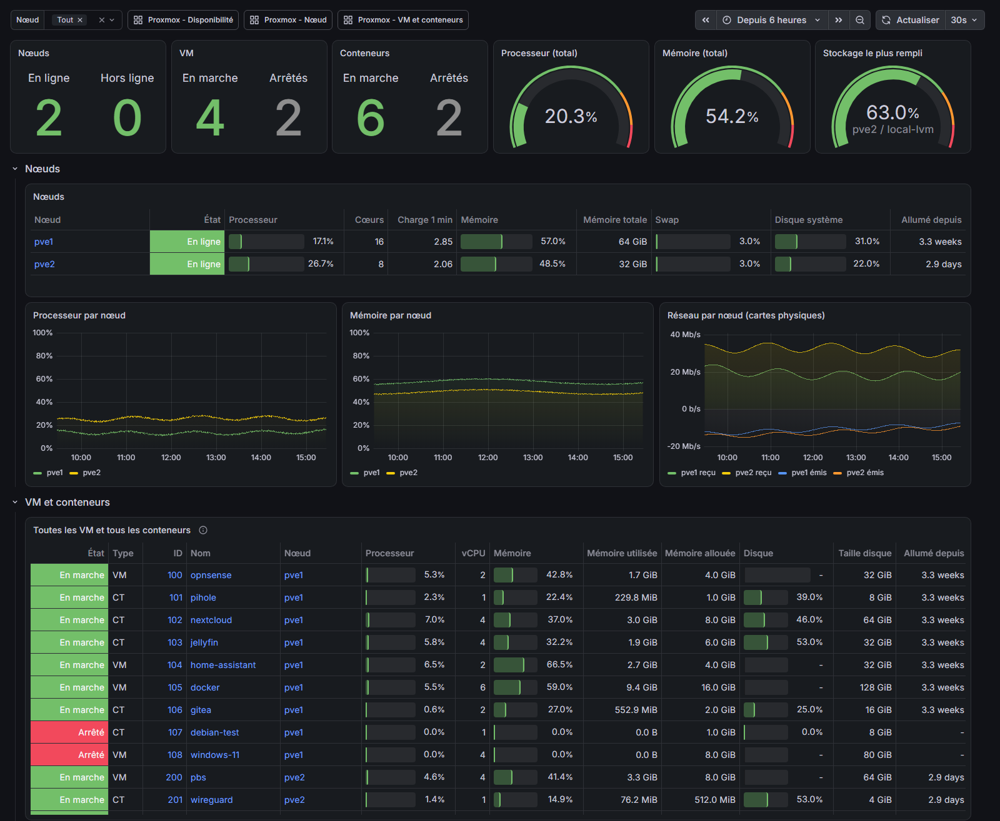
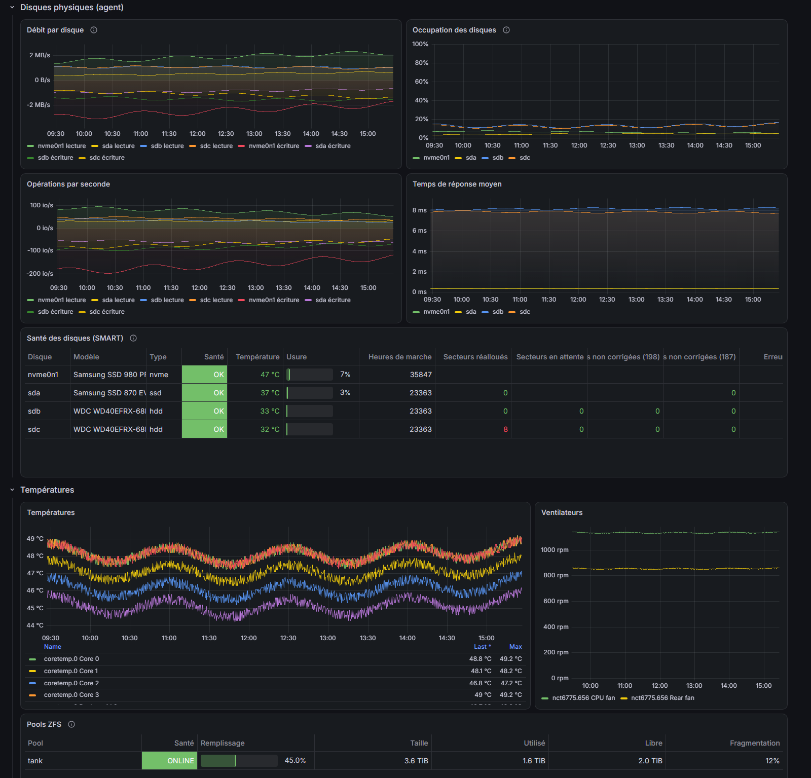
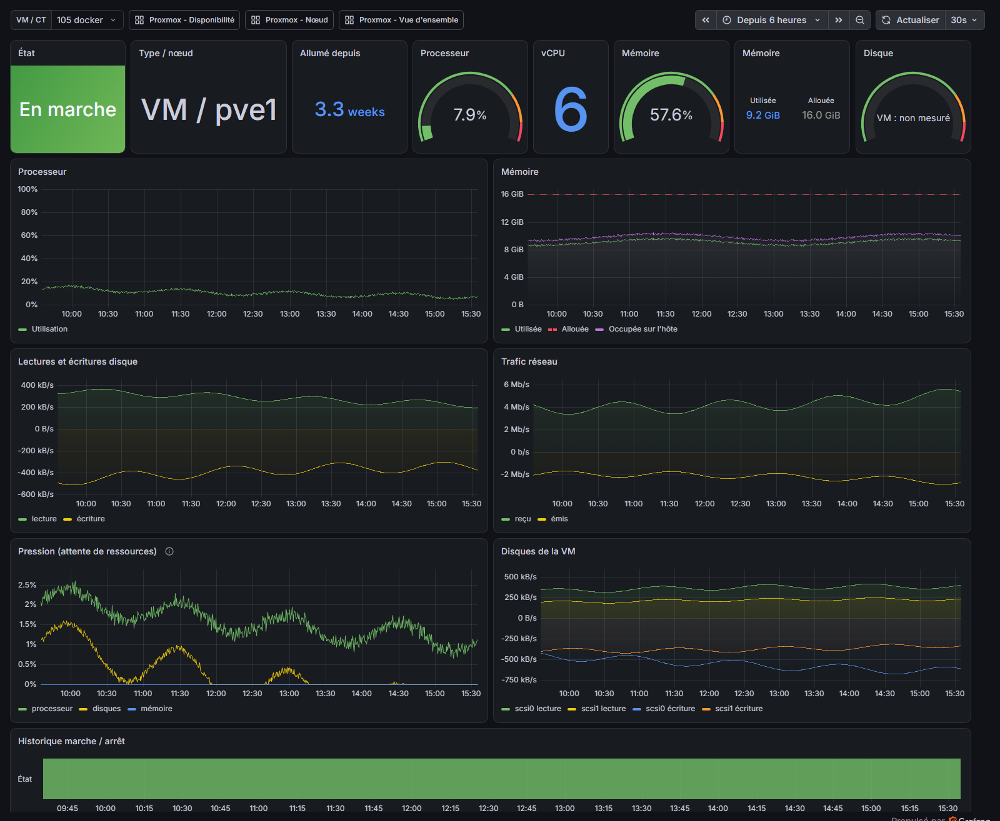
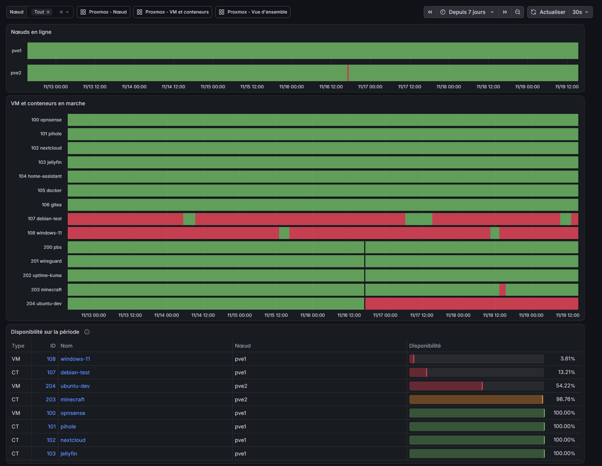

# proxmox-grafana

Full monitoring of a Proxmox VE server with Grafana and InfluxDB, installed with a single command.

Version française : [README.md](README.md)

The script creates a dedicated Debian container, installs InfluxDB 2 and Grafana in it, tells Proxmox to send its metrics there and adds ready-to-use dashboards. It asks a few simple questions during the installation, each with a default answer: you can just press Enter all the way.

## Screenshots

Taken with demo data, French version of the dashboards (English dashboards are installed when you pick English).

Overview: nodes, VMs and containers, load, memory, storages.



Physical disks, SMART health, temperatures and ZFS (with the agent).



Details of a VM or container.



On / off history and availability.



## What is monitored

- nodes: CPU, load, memory, swap, ZFS cache, system disk, network per interface, uptime, online or not;
- every VM and container: running or stopped, CPU, memory, disk, reads and writes, network traffic, pressure (waiting for resources), drives of each VM;
- storages: current usage and history, shared storages counted once;
- physical disks (with the agent): throughput, busy time, operations per second, response time;
- disk health (with the agent): SMART status, temperature, SSD and NVMe wear, reallocated or pending sectors, errors;
- temperatures and fans (with the agent);
- ZFS pools (with the agent): state, usage, fragmentation;
- on / off history of all of the above and availability over the selected period.

Everything adapts by itself: number of nodes, VMs, containers, disks, interface and storage names.

## Installation

In the shell of a Proxmox node (web interface, node, Shell, or SSH as root):

```bash
bash -c "$(curl -fsSL https://raw.githubusercontent.com/tom-lion38/proxmox-grafana/main/install.sh)"
```

Or with git:

```bash
git clone https://github.com/tom-lion38/proxmox-grafana.git
cd proxmox-grafana
bash install.sh
```

Requirements:

- Proxmox VE 7, 8 or 9;
- Internet access from the node and from the container (Debian template and official InfluxDB and Grafana packages);
- about 2 GB of free memory and 20 GB of free disk.

The installation takes 3 to 6 minutes.

## Questions asked

In simple mode (default):

1. language (French or English);
2. container storage, if there is more than one choice;
3. network bridge, if there is more than one;
4. container IP address: automatic (DHCP) or static;
5. Grafana password: generated or chosen;
6. agent on the node (and on the other nodes of a cluster);
7. a summary before starting.

Advanced mode also lets you choose the container ID, name, cores, memory, disk size, VLAN and how long measurements are kept (30 days, 90 days, 180 days, 1 year or forever).

With DHCP, reserve the container address in your router. If it changes, Proxmox can no longer send its metrics.

## After the installation

The script shows the Grafana address, the `admin` user and the password. These details are also written to `/root/proxmox-grafana.txt` on the node (readable by root only).

Dashboards are in the "Proxmox" folder in Grafana. The overview opens right after login. Graphs start filling within the first minute.

## Dashboards

| Dashboard | Content |
| --- | --- |
| Proxmox - Overview | Nodes online, VMs and containers running or stopped, cluster CPU and memory, list of all guests, busiest guests, storages |
| Proxmox - Node | Node details: CPU, load, memory, network, storages, physical disks, SMART, temperatures, fans, ZFS, guests on the node |
| Proxmox - VMs and containers | Details of a VM or container, on / off history |
| Proxmox - Availability | On / off timeline of nodes and guests, availability percentage |

Click the name of a VM, container or node to open its details.

Installed dashboards are protected against changes (they are replaced on every update). To customize one, use "Save as" in Grafana: the copy is yours.

## The agent

Proxmox sends the state and load of nodes, VMs, containers and storages by itself. It does not measure physical disks, temperatures, SMART health or ZFS pools: that is what the agent does.

The agent is a bash script (`/usr/local/bin/proxmox-grafana-agent`) run by systemd. It installs no package and only reads `/proc`, `/sys`, `smartctl` and `zpool`, which are already on Proxmox. It sends its measurements every 15 seconds, and SMART status every 10 minutes without waking sleeping disks.

To see what it sends, without sending anything:

```bash
proxmox-grafana-agent --print
```

## Cluster

The Proxmox metric server is a cluster-wide setting: all nodes send their metrics right after the installation. The script offers to install the agent on the other nodes too (over SSH between nodes). To add it later on a node, run the script on that node and choose "Add the agent on this node".

## Update, uninstall

Run the same command again: a menu offers installation, dashboard and agent update, adding the agent and uninstalling. Or directly:

```bash
bash -c "$(curl -fsSL https://raw.githubusercontent.com/tom-lion38/proxmox-grafana/main/install.sh)" -- --update-dashboards
bash -c "$(curl -fsSL https://raw.githubusercontent.com/tom-lion38/proxmox-grafana/main/install.sh)" -- --uninstall
```

Uninstalling removes the metric server and the agent. It asks before deleting the container and its history.

## Unattended installation

For automated deployments, add `--unattended` and set what you need with variables (all optional):

```bash
PG_LANG=en PG_IP=192.168.0.240/24 PG_GW=192.168.0.1 PG_RETENTION=180 \
  bash install.sh --install --unattended
```

| Variable | Purpose | Default |
| --- | --- | --- |
| `PG_LANG` | `fr` or `en` | from the system language |
| `PG_CTID` | container ID | first free one |
| `PG_HOSTNAME` | container name | `proxmox-grafana` |
| `PG_STORAGE` | container storage | `local-lvm` or `local-zfs`, else the one with most free space |
| `PG_TEMPLATE_STORAGE` | template storage | `local` |
| `PG_DISK` | disk in GB | `20` |
| `PG_RAM` | memory in MB | `2048` |
| `PG_CORES` | cores | `2` |
| `PG_BRIDGE` | network bridge | `vmbr0` |
| `PG_VLAN` | VLAN tag | none |
| `PG_IP` | `dhcp` or `a.b.c.d/nn` | `dhcp` |
| `PG_GW` | gateway (static address) | the node gateway |
| `PG_RETENTION` | retention in days, `0` for forever | `90` |
| `PG_GRAFANA_PASSWORD` | Grafana password | generated |
| `PG_AGENT` | install the agent (`1` or `0`) | `1` |
| `PG_AGENT_ALL_NODES` | agent on every cluster node | `1` |
| `PG_DESTROY_CT` | delete the container when uninstalling | `0` |

## What the script changes on Proxmox

- one unprivileged LXC container, tagged `proxmox-grafana`;
- one metric server named `proxmox-grafana` (Datacenter, Metric Server). Existing ones are left untouched;
- the agent: `/usr/local/bin/proxmox-grafana-agent`, the `proxmox-grafana-agent` service and `/etc/proxmox-grafana/`;
- `/root/proxmox-grafana.txt` and the log `/var/log/proxmox-grafana.log`.

Nothing else. If an error happens during the installation, the script offers to remove what it created. If the connection drops, it removes it by itself: just run it again.

## Security

- Grafana (port 3000) and InfluxDB (port 8086) are meant to stay on the local network. Do not expose them to the Internet.
- Proxmox and the agent write with a token that can only write to the `proxmox` bucket. Grafana reads with a token that can only read.
- Passwords are random. The InfluxDB one is in `/root/proxmox-grafana.txt`.
- Packages come from the official InfluxData (key checked) and Grafana repositories. Usage statistics of InfluxDB and Grafana are turned off.

## Troubleshooting

- The full log is in `/var/log/proxmox-grafana.log`.
- "No data" everywhere: check that the node can reach the container on port 8086 (firewall, VLAN, address changed by DHCP).
- Nothing in the "agent" parts: `systemctl status proxmox-grafana-agent` and `journalctl -u proxmox-grafana-agent`.
- No temperatures: some virtual machines or motherboards expose no sensor.
- The container gets no address: without a DHCP server on that network, choose a static address.

## Changing the dashboards

The files in `dashboards/fr` and `dashboards/en` are generated by `tools/build-dashboards.py` (one definition for both languages):

```bash
python3 tools/build-dashboards.py
```

`tools/check-dashboards.py` runs every query through the Grafana API and reports errors and empty panels.

## License

MIT, see [LICENSE](LICENSE).
